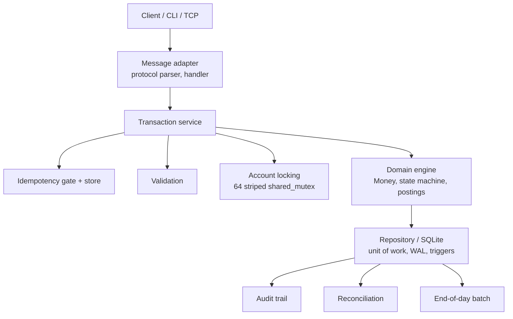
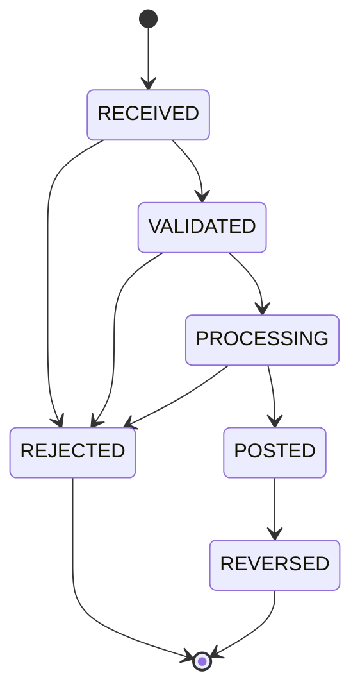

# CoreBank Transaction Engine C++

Production-style educational C++ transaction-processing engine demonstrating
financial-system correctness, concurrency, batch processing and Linux operational
automation.

Built with C++20, CMake and SQLite, it posts credits, debits, transfers and reversals
through an idempotent, audited, double-entry journal; runs them through a bounded worker
pool behind a TCP line protocol; reconciles the ledger against its own postings; and
closes the day with a restartable end-of-day batch driven by bash scripts. The code is
small enough to read in an afternoon and the test suite proves the controls rather than
just the happy path.

> **Disclaimer.** This is an independent educational implementation using synthetic data
> and generic banking concepts. It is not derived from or representative of any employer
> production system.

> **Development history note.** This project was developed progressively beginning in late 2025 and
> was later consolidated for public release. Because complete original Git metadata was not retained,
> portions of the repository history were reconstructed around known implementation phases.
> Historical dates should be understood as approximate development milestones.
> See [docs/HISTORY_RECONSTRUCTION.md](docs/HISTORY_RECONSTRUCTION.md).

[](https://github.com/Adetlo/corebank-transaction-engine-cpp/actions/workflows/ci.yml)


**What this demonstrates**

* Exact money: `int64_t` minor units with overflow-checked arithmetic, no floating point anywhere near an amount
* Atomic transfers: journal legs, balances, audit events and the idempotency record commit together or not at all
* Idempotency under concurrency: same key replays, changed request conflicts, twelve threads with one key commit once
* A tested transaction state machine: `RECEIVED` to `VALIDATED` to `PROCESSING` to `POSTED`, `REJECTED` and `REVERSED`
* Modern C++ concurrency with a purpose: `std::jthread` workers, a bounded queue with `std::stop_token`, striped `std::shared_mutex` account locks in a fixed order, graceful shutdown on `SIGTERM`
* Append-only history: reversals are new linked transactions; SQLite triggers refuse updates and deletes of postings and audit events
* Reconciliation that fails loudly: seven checks, non-zero exit code, audit trail
* Restartable end-of-day batch: eight stages, each individually committed, failure injection with `COREBANK_FAIL_STAGE`, resume skips completed stages
* Linux operations: eleven ShellCheck-clean bash scripts, structured JSON logs, pid files, exit-code contract, systemd unit example, non-root Docker image with health check
* Quality gates in CI: GCC and Clang builds, clang-format, clang-tidy, cppcheck, ShellCheck, AddressSanitizer, UndefinedBehaviorSanitizer, ThreadSanitizer, Docker smoke test, CodeQL

---

## Contents

1. [Why this project](#1-why-this-project)
2. [What it demonstrates](#2-what-it-demonstrates)
3. [Architecture](#3-architecture)
4. [Core controls](#4-core-controls)
5. [Concurrency model](#5-concurrency-model)
6. [Transaction processing](#6-transaction-processing)
7. [Batch / EOD](#7-batch--eod)
8. [Linux operations](#8-linux-operations)
9. [Shell automation](#9-shell-automation)
10. [Testing](#10-testing)
11. [Build](#11-build)
12. [Quick start](#12-quick-start)
13. [Demo](#13-demo)
14. [Benchmarks](#14-benchmarks)
15. [Security](#15-security)
16. [Limitations](#16-limitations)
17. [Architecture decisions](#17-architecture-decisions)
18. [Related portfolio projects](#18-related-portfolio-projects)
19. [Disclaimer](#19-disclaimer)

---

## 1. Why this project

Core banking platforms are built from a small number of hard problems: money must be
exact, every movement must be atomic and auditable, retries must not double-post,
concurrent requests must not corrupt balances, and the day must close with the ledger
reconciled, whatever failed along the way. Most of that work happens far below any web
framework, in compiled services, batch jobs and shell scripts on Linux and Unix hosts.

This repository implements those problems from first principles in C++20 so that the
controls are visible in the code rather than delegated to a framework. It is the
systems-engineering chapter of a four-part portfolio: the [ledger](#18-related-portfolio-projects)
records value, the pipeline curates it, the ML service scores it, and this engine shows
how the transaction path and its operations are built at the systems level.

## 2. What it demonstrates

| Area | Where to look |
| --- | --- |
| Strong domain types (`Money`, `CurrencyCode`, `AccountId`, `TransactionId`, `IdempotencyKey`, `JournalReference`) | `include/corebank/domain/` |
| Explicit error model (`Result<T>`, stable `ErrorCode` names) instead of exceptions | `include/corebank/domain/result.hpp`, [ADR-0007](docs/ADR/0007-error-handling.md) |
| Transaction service: validation, idempotency, locking, posting, reversal | `src/application/transaction_service.cpp` |
| Worker pool with bounded queue and graceful shutdown | `src/application/transaction_processor.cpp` |
| Repository abstraction with a SQLite implementation (WAL, triggers, optimistic versioning) | `include/corebank/application/repository.hpp`, `src/infrastructure/sqlite/` |
| Reconciliation and end-of-day batch | `src/application/reconciliation_service.cpp`, `src/batch/eod_service.cpp` |
| TCP line protocol, parser, handler, server and client (POSIX sockets, no Boost) | `src/messaging/` |
| Signal handling, structured logging, configuration | `src/infrastructure/` |
| Professional CLI with exit-code contract | `src/cli/` |
| Operational scripts, systemd unit, Docker | `scripts/`, `systemd/`, `Dockerfile`, `docker-compose.yml` |
| 31 test executables, 160 cases across unit, integration, concurrency, batch, messaging, property and CLI | `tests/` |

## 3. Architecture



Layered and dependency-ruled: `domain` knows nothing about SQLite or sockets,
`application` depends on the domain and the repository interfaces, `infrastructure`
implements them, `messaging`, `batch` and `cli` sit on top. A single static library
(`corebank_core`) is shared by the CLI, the benchmark and every test. Details:
[docs/ARCHITECTURE.md](docs/ARCHITECTURE.md), [docs/DOMAIN_MODEL.md](docs/DOMAIN_MODEL.md).

```
include/corebank/   public headers by layer (domain, application, infrastructure, messaging, batch, cli)
src/                implementation, same layout, plus bench/
tests/              unit, integration, concurrency, batch, messaging, property, cli, support
scripts/            build, test, start, stop, healthcheck, run_eod, reconcile, smoke_test, benchmark, clean, demo
config/             default.yaml (flat key: value, overridden by COREBANK_* environment variables)
systemd/            corebank-engine.service (example)
docs/               architecture, domain model, concurrency, idempotency, persistence, EOD, operations, shell automation, testing, security, limitations, benchmarks, ADRs
```

## 4. Core controls

| Control | How it is enforced | Proven by |
| --- | --- | --- |
| Exact money | `Money` holds `int64_t` minor units per currency; `__builtin_*_overflow` guards every operation; parsing rejects excess decimals | `tests/unit/money_test.cpp` |
| Atomic transfer | One `BEGIN IMMEDIATE` transaction holds the transaction row, both postings, both balance updates, the audit events and the idempotency record | `tests/integration/rollback_test.cpp` (injected commit and posting failures leave no trace) |
| Idempotency | Key required for every financial request; canonical request signature stored and compared verbatim; in-process gate serialises in-flight duplicates; primary key in `idempotency_records` is the backstop | `tests/integration/idempotency_test.cpp`, `tests/concurrency/concurrent_idempotency_test.cpp` |
| Duplicate detection | Same key with the same request replays the stored outcome (`replayed=1`); a different request returns `IDEMPOTENCY_CONFLICT` | same |
| Insufficient funds | `Account::balance_after_debit` refuses to go negative unless `allow_overdraft`; the rejection is itself persisted as a `REJECTED` transaction with an audit event | `tests/integration/transaction_service_test.cpp` |
| Validation | Identifiers, amounts, currencies, references and wire messages are validated at the boundary with structured error codes | `tests/unit/identifiers_test.cpp`, `tests/unit/protocol_test.cpp` |
| Transaction references | Every transaction carries a journal reference and, for reversals, `reversal_of` / `reversed_by` links | `tests/integration/reversal_test.cpp` |
| Audit trail | `ACCOUNT_CREATED`, `TRANSACTION_RECEIVED`, `TRANSACTION_POSTED`, `TRANSACTION_REJECTED`, `TRANSACTION_REVERSED`, `RECONCILIATION_RUN`, `BATCH_*`, `ENGINE_*`; SQLite triggers refuse `UPDATE` and `DELETE` | `tests/integration/audit_test.cpp` |
| State machine | `can_transition` is the only way to move a transaction; terminal states are frozen at the storage level too | `tests/unit/state_machine_test.cpp` |

## 5. Concurrency model

Threads in a running engine: one acceptor, one `std::jthread` per TCP connection
(bounded by `max_connections`), `worker_count` processor workers draining a bounded
queue, and the main thread waiting on the signal pipe.

Lock order, never varied: **idempotency gate, then account stripes in ascending index,
then the repository writer mutex, then the SQLite write transaction.** Every resource is
acquired in increasing rank and released through RAII in reverse, so no wait-for cycle
can form. Readers take the shared side of a stripe and a `BEGIN DEFERRED` transaction.
SQLite serialises writers anyway; the stripes and the writer mutex make contention on
the same account queue in a defined order instead of retrying in SQLite's busy handler,
and they are the part that carries over to a database with row-level locking.

`TransactionProcessor` is the only place `std::thread`-style parallelism is used, and it
is used for back-pressure and isolation rather than decoration: `submit()` waits up to
`enqueue_timeout` for queue space and then fails with `QUEUE_FULL`; `shutdown_gracefully()`
stops accepting, lets workers drain and joins; `shutdown_now()` fails queued work with
`SHUTTING_DOWN`. Tests prove balance consistency under same-account contention,
opposite-direction transfers and a randomised mesh, deadlock safety under a hard
deadline, and signal-driven shutdown that finishes queued work. Details:
[docs/CONCURRENCY.md](docs/CONCURRENCY.md), [ADR-0003](docs/ADR/0003-locking-strategy.md).

## 6. Transaction processing



A `CREDIT` or `DEBIT` posts one leg (external money entering or leaving the engine); a
`TRANSFER` posts a debit and a credit of equal amount; a `REVERSAL` is a new transaction
with the original's legs swapped, linked both ways. Nothing is ever deleted: a second
reversal of the same transaction is refused, a reversal of a reversal is refused, and a
reversal that would overdraw an account is recorded as `REJECTED`.

Every request is answered with a receipt: `POSTED`, `REJECTED` with a reason code, or a
replay of either. Wire protocol (one line per message, generic and deliberately simple):

```
TRANSFER|key=ORDER-42|from=CUSTOMER-A|to=CUSTOMER-B|amount=12.50|ccy=GBP|ref=rent
OK|txn_id=TXN-5F1C...|type=TRANSFER|status=POSTED|amount=12.50|ccy=GBP|replayed=0
TRANSFER|key=ORDER-42|from=CUSTOMER-A|to=CUSTOMER-B|amount=13.00|ccy=GBP
ERR|code=IDEMPOTENCY_CONFLICT|message=idempotency key ORDER-42 was already used for a different request
```

Malformed messages, missing fields, invalid currency or amount, oversized payloads
(4096 bytes per line, 32 fields, 512 bytes per value), idle connections and too many
connections all return structured `ERR|code=...` responses. Details:
[docs/IDEMPOTENCY.md](docs/IDEMPOTENCY.md), [docs/DOMAIN_MODEL.md](docs/DOMAIN_MODEL.md).

## 7. Batch / EOD

`corebank eod run` executes eight stages for a business date:

`PRECHECK` → `TRANSACTION_CUTOFF` → `VALIDATE_PENDING` → `BALANCE_CHECK` → `RECONCILIATION` → `DAILY_SUMMARY` → `ARCHIVE` → `COMPLETE`

Each stage is recorded as `RUNNING` in its own committed transaction before it starts,
and its `COMPLETED` status commits atomically with its work, so a crash mid-stage leaves
evidence and the stage re-runs on restart while completed stages are skipped. A second
run for a completed date is a no-op. Every transition is audited (`BATCH_STARTED`,
`BATCH_RESUMED`, `BATCH_STAGE_STARTED`, `BATCH_STAGE_COMPLETED`, `BATCH_STAGE_FAILED`,
`BATCH_FAILED`, `BATCH_COMPLETED`).

```bash
COREBANK_FAIL_STAGE=RECONCILIATION corebank eod run     # exit 3, batch FAILED at stage 5
corebank eod status                                     # shows the failed stage and attempts
corebank eod run                                        # resumes: stages 1 to 4 skipped, 5 to 8 run
```

Outputs under `batch_dir/<date>/`: `daily_summary.json` (per-currency totals) and
`transactions.csv` (an export; nothing is removed from the database), both mode `0640`.
Details: [docs/EOD_BATCH.md](docs/EOD_BATCH.md), [ADR-0006](docs/ADR/0006-eod-restart-model.md).

## 8. Linux operations

* **Service lifecycle**: `scripts/start.sh` (nohup, pid file, waits for the TCP health
  check), `scripts/stop.sh` (`SIGTERM`, then `SIGKILL` after a grace period),
  `scripts/healthcheck.sh` (TCP `PING` or database integrity check).
* **Signals**: `SIGTERM` and `SIGINT` stop accepting connections, drain the queue, audit
  `ENGINE_STOPPED` and exit 0; `SIGPIPE` is ignored. Implemented with an
  async-signal-safe self-pipe (`src/infrastructure/signal_handler.cpp`).
* **Logging**: one JSON object per line with `ts`, `level`, `event`, and
  `transaction_id`, `account_id`, `duration_ms` where relevant; stderr by default or
  `log_file`. Account names and free-text references never reach the log.
* **Configuration**: `config/default.yaml` (flat `key: value`) overridden by
  `COREBANK_*` environment variables; `corebank config show` prints the effective values.
* **Exit codes**: `0` ok, `1` usage, `2` business rejection, `3` control failure
  (reconciliation or EOD), `4` system error. Scripts use the same contract.
* **systemd**: `systemd/corebank-engine.service` is a labelled example that runs as a
  non-root user, restarts on failure, reads environment configuration and stops
  gracefully with `TimeoutStopSec=30`.
* **Docker**: multi-stage image (141 MB locally, no compiler in the runtime stage),
  `USER corebank` (uid 10001), `HEALTHCHECK` through `corebank health`, `STOPSIGNAL
  SIGTERM`; `docker compose up` starts the engine, `docker compose run --rm demo` runs the
  full demo against it.

Details: [docs/OPERATIONS.md](docs/OPERATIONS.md).

## 9. Shell automation

Eleven scripts share `scripts/lib/common.sh`: `set -euo pipefail`, one environment
contract (`COREBANK_HOME`, `BUILD_DIR`, `COREBANK_DB`, `COREBANK_BATCH_DIR`,
`COREBANK_LOG_DIR`, `COREBANK_PID_FILE`, `COREBANK_HOST`, `COREBANK_PORT`), structured
`ts= level= script= msg=` logging to stderr, documented exit codes and log locations,
and compatibility with bash 3.2 as well as 5. ShellCheck runs on every script in CI with
`-S style`.

| Script | Purpose |
| --- | --- |
| `build.sh` | CMake configure and build (`--debug`, `--asan`, `--ubsan`, `--tsan`, `--coverage`, `--no-tests`) |
| `test.sh [label]` | ctest, whole suite or one category |
| `start.sh` / `stop.sh` / `healthcheck.sh` | engine lifecycle and monitoring |
| `run_eod.sh [date]` / `reconcile.sh [date]` | daily controls with per-run logs under `COREBANK_LOG_DIR` |
| `smoke_test.sh` | 23 end-to-end checks on a throw-away database (CLI, TCP, EOD) |
| `benchmark.sh` | local synthetic benchmark, JSON output |
| `clean.sh [--all]` | remove build output and, optionally, runtime state |
| `demo.sh` | guided demo, see below |

Details: [docs/SHELL_AUTOMATION.md](docs/SHELL_AUTOMATION.md).

## 10. Testing

| Category | Executables | Cases | What it proves |
| --- | ---: | ---: | --- |
| unit | 14 | 69 | money, currency, strong ids, `Result`, timestamps, state machine, account rules, config, logger, JSON, protocol, bounded queue, lock manager, CLI args |
| integration | 7 | 44 | service flows on a real SQLite file: idempotency, reversal, audit immutability, reconciliation on tampered data, persistence, rollback on injected failures |
| concurrency | 4 | 12 | same-account contention, opposite-direction transfers, randomised mesh, twelve threads with one key, processor back-pressure and shutdown, deadlock deadline |
| batch | 1 | 7 | every stage, idempotent re-run, failure injection in each stage, resume, stale pending rejection |
| messaging | 3 | 19 | handler error codes, TCP limits and timeouts, duplicate messages over the wire, signal-driven shutdown |
| property | 1 | 3 | deterministic randomised invariants: conservation, no negative balance without overdraft, reversal restores net state, posting chain equals balance |
| cli | 1 | 6 | the real binary: exit codes, JSON output, EOD failure and resume, reconcile on corruption |

Sanitizers: the ASan + UBSan job runs the whole suite and allows no findings; the
ThreadSanitizer job runs every suite that spawns threads or sockets. Static analysis:
clang-tidy (`.clang-tidy`, warnings are errors), cppcheck (`.cppcheck-suppressions`), and
ShellCheck; every disabled check is listed with its reason in
[docs/TESTING.md](docs/TESTING.md). Property-style tests use seeded `std::mt19937`
instead of a RapidCheck dependency.

## 11. Build

Requirements: a C++20 compiler (GCC 13+ or Clang 16+; Apple clang works with the flag
CMake adds automatically), CMake 3.22+, SQLite 3 headers, bash. GoogleTest 1.17 is
fetched at configure time.

```bash
# Debian / Ubuntu
sudo apt-get install build-essential cmake ninja-build libsqlite3-dev

scripts/build.sh                 # Release build into ./build
scripts/test.sh                  # 31 executables, 160 cases
scripts/build.sh --debug --asan --ubsan && scripts/test.sh
scripts/build.sh --debug --tsan && scripts/test.sh concurrency
```

Or directly: `cmake -S . -B build -G Ninja -DCMAKE_BUILD_TYPE=Release && cmake --build
build && ctest --test-dir build`.

## 12. Quick start

```bash
export COREBANK_DB=/tmp/corebank/engine.db COREBANK_BATCH_DIR=/tmp/corebank/batch
B=build/corebank

$B account create --id SETTLEMENT-GBP --name "Settlement Account" --currency GBP --type SETTLEMENT
$B account create --id CUSTOMER-A --name "Customer A" --currency GBP
$B transaction credit --account SETTLEMENT-GBP --amount 1000000.00 --currency GBP --key OPEN-1
$B transfer --from SETTLEMENT-GBP --to CUSTOMER-A --amount 250.50 --currency GBP --key T-1 --reference payroll
$B transfer --from SETTLEMENT-GBP --to CUSTOMER-A --amount 250.50 --currency GBP --key T-1   # replayed
$B account history --id CUSTOMER-A
$B reconcile                      # exit 0 when every check passes, 3 otherwise
$B eod run && $B eod status
$B audit --limit 20

$B serve &                        # TCP listener on 127.0.0.1:7400
$B send --host 127.0.0.1 --port 7400 "TRANSFER|key=T-2|from=SETTLEMENT-GBP|to=CUSTOMER-A|amount=10.00|ccy=GBP"
$B health --host 127.0.0.1 --port 7400
kill -TERM %1                     # graceful stop
```

Docker: `docker compose up -d` then `docker compose run --rm demo`; or
`docker build -t corebank .` and `docker run -p 127.0.0.1:7400:7400 corebank`.

## 13. Demo

`scripts/demo.sh` builds the engine, creates four synthetic accounts (Customer A,
Customer B, a settlement account and a fee income account), credits the settlement
account, runs transfers with replay, conflict and rejection, starts the engine, drives a
concurrent workload of eight TCP clients in opposite directions, reverses the fee,
reconciles, stops the engine, runs end-of-day with an injected failure at
`RECONCILIATION`, resumes it to completion, prints the audit trail and the batch files,
and cleans up. Excerpt of a real run:

```
==> End-of-day batch with an injected failure at RECONCILIATION
  PRECHECK             COMPLETED  attempts=1  storage ok, no other batch running, batch directory writable
  TRANSACTION_CUTOFF   COMPLETED  attempts=1  cutoff at 2026-10-14T14:34:48.553888Z, 206 transactions dated 2026-10-14
  VALIDATE_PENDING     COMPLETED  attempts=1  0 stale pending transactions rejected
  BALANCE_CHECK        COMPLETED  attempts=1  4 account balances verified against postings
  RECONCILIATION       FAILED     attempts=1  injected failure (COREBANK_FAIL_STAGE=RECONCILIATION)
  DAILY_SUMMARY        PENDING    attempts=0
  ...
==> End-of-day restarted: completed stages are skipped, the batch completes
  RECONCILIATION       COMPLETED  attempts=2  reconciliation PASSED (7/7 checks passed)
  DAILY_SUMMARY        COMPLETED  attempts=1  1 currency summaries written to .../batch/2026-10-14/daily_summary.json
  ARCHIVE              COMPLETED  attempts=1  206 transactions archived to .../batch/2026-10-14/transactions.csv
  COMPLETE             COMPLETED  attempts=1  batch completed
batch resumed and completed (attempt 2)
```

## 14. Benchmarks

Local synthetic benchmark (`corebank-bench`, Apple M3 laptop, Release build, SQLite WAL
on local SSD, 2026-10-14). These numbers describe this code on that machine only and are
not a production-bank performance claim.

| run (32 accounts, 5000 transfers, 4 workers, 32 in flight) | per second | p50 ms | p95 ms |
| --- | ---: | ---: | ---: |
| single-thread transfers (service call) | 3315 | 0.225 | 0.289 |
| multi-thread transfers (through the processor, latency includes queueing) | 2947 | 12.5 | 13.9 |
| end-of-day batch (rows processed) | 37067 | n/a | n/a |

Worker threads do not raise write throughput on SQLite, which admits one writer at a
time; the pool exists for back-pressure and isolation. [docs/BENCHMARKS.md](docs/BENCHMARKS.md)
explains the method and how to read the numbers.

## 15. Security

Input validation at every boundary, bounded payloads and queues, parameterised SQL only,
immutability triggers and `CHECK` constraints, loopback listener by default, non-root
container, restrictive file permissions, no credentials anywhere, sanitizers and static
analysis in CI, CodeQL and Dependabot. Authentication, authorisation and transport
encryption are out of scope for v1 and the engine is meant to sit behind a trusted
gateway. Threat model and controls: [docs/SECURITY.md](docs/SECURITY.md); reporting:
[SECURITY.md](SECURITY.md).

## 16. Limitations

Single-process SQLite with one writer at a time; no authentication or TLS; plain-text
protocol; no FX or multi-currency transfers; account status cannot be changed through
the CLI or protocol; reversals are whole and single-level; EOD is run by an operator or
scheduler, not by the engine; idempotency keys never expire; the in-process gate and
stripes do not span processes. The full list with reasoning is in
[docs/LIMITATIONS.md](docs/LIMITATIONS.md).

## 17. Architecture decisions

| ADR | Decision |
| --- | --- |
| [0001](docs/ADR/0001-cpp20.md) | C++20 as the language baseline (`jthread`, `stop_token`, `span`, `<=>`, designated initialisers) |
| [0002](docs/ADR/0002-money-representation.md) | Money as `int64_t` minor units with a currency code and checked arithmetic |
| [0003](docs/ADR/0003-locking-strategy.md) | Fixed lock order: idempotency gate, striped account locks, writer mutex, database transaction |
| [0004](docs/ADR/0004-sqlite.md) | SQLite in WAL mode behind a repository interface |
| [0005](docs/ADR/0005-idempotency-design.md) | Verbatim request signatures, in-flight gate, database primary key as backstop |
| [0006](docs/ADR/0006-eod-restart-model.md) | Per-stage committed status, resume skips completed stages |
| [0007](docs/ADR/0007-error-handling.md) | `Result<T>` values instead of exceptions for domain outcomes |

## 18. Related portfolio projects

| Project | Role in the story |
| --- | --- |
| [corebank-ledger](https://github.com/Adetlo/corebank-ledger) | Financial systems: double-entry ledger service in Python, FastAPI and PostgreSQL |
| **corebank-transaction-engine-cpp** (this repository) | Systems engineering: C++20 transaction engine, concurrency, batch processing, Linux operations |
| [txn-data-pipeline](https://github.com/Adetlo/txn-data-pipeline) | Data engineering: validation, reconciliation and lineage for transaction exports |
| [fraud-detection-ml](https://github.com/Adetlo/fraud-detection-ml) | Applied ML: fraud risk scoring with model governance |

Each repository is independent, uses synthetic data only, and can be cloned and run on
its own.

## 19. Disclaimer

This is an independent educational implementation using synthetic data and generic
banking concepts. It is not derived from or representative of any employer production
system. Account identifiers, names, amounts and messages in this repository, its tests,
examples and demo are fictional. Licensed under the [MIT License](LICENSE).
