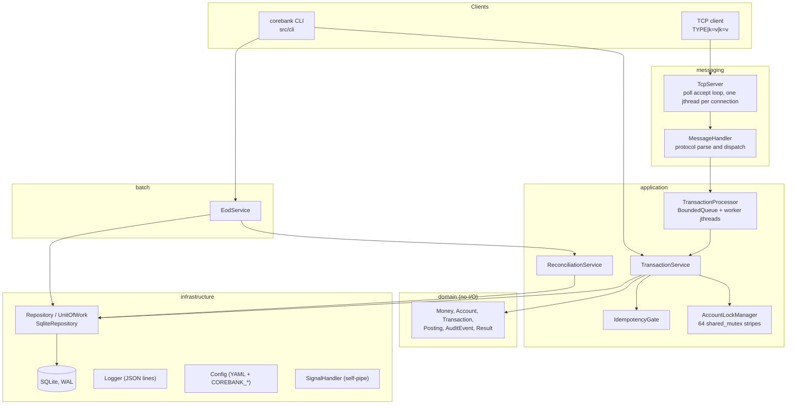
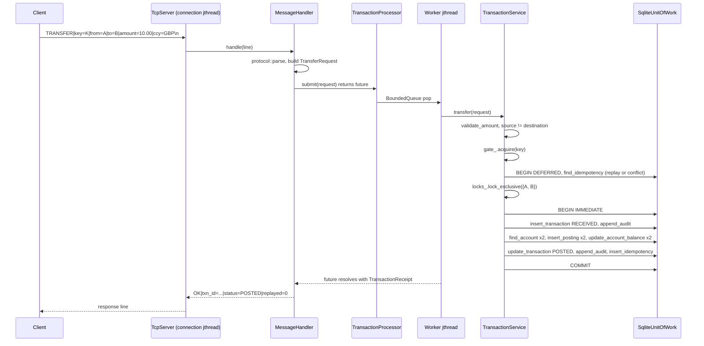

# Architecture

This document describes how the CoreBank Transaction Engine is put together: the layers, the build targets, the dependency rules between layers, the path a request takes through the process, and where each cross-cutting concern lives.

The engine is an independent educational implementation. It uses synthetic data and generic banking concepts (accounts, double-entry postings, idempotent requests, an end-of-day batch). It is not modelled on any specific institution or product, and no claim is made about production performance.

Related documents: [DOMAIN_MODEL.md](DOMAIN_MODEL.md), [CONCURRENCY.md](CONCURRENCY.md), [IDEMPOTENCY.md](IDEMPOTENCY.md), [PERSISTENCE.md](PERSISTENCE.md), [EOD_BATCH.md](EOD_BATCH.md), [OPERATIONS.md](OPERATIONS.md), [TESTING.md](TESTING.md).

## Purpose and scope

The engine accepts financial requests (credit, debit, transfer, reversal), validates them, posts double-entry legs to SQLite inside one database transaction, records an audit trail, and guarantees that a retried request with the same idempotency key produces the same outcome exactly once. A separate batch service runs a restartable end-of-day pipeline over the same database.

Everything runs in one process: a `corebank` binary that either executes a single command against the database or serves a line-oriented TCP protocol (`corebank serve`).

## Layered view



The arrows show the direction of calls and compile-time dependencies. The domain layer is at the bottom and knows nothing about SQLite, sockets, or threads.

## Directory layout

| Path | Contents |
| --- | --- |
| `include/corebank/domain/`, `src/domain/` | Value objects and aggregates: `Money`, `CurrencyCode`, `Identifier<Tag>`, `Account`, `Transaction` (state machine), `Posting`, `AuditEvent`, `BatchRun`, `ReconciliationResult`, `Result<T>`, `Error`, `Clock`. |
| `include/corebank/application/`, `src/application/` | `TransactionService`, `TransactionProcessor`, `BoundedQueue`, `IdempotencyGate`, `AccountLockManager`, `IdGenerator`, `ReconciliationService`, and the `Repository` / `UnitOfWork` interfaces in `repository.hpp`. |
| `include/corebank/infrastructure/`, `src/infrastructure/` | `Config`, `Logger`, `JsonWriter`, `SignalHandler`, `errno_text`, and `sqlite/` (`Connection`, `Statement`, `schema`, `SqliteRepository`). |
| `include/corebank/messaging/`, `src/messaging/` | `protocol` (line format), `MessageHandler`, `TcpServer`, `TcpClient`. |
| `include/corebank/batch/`, `src/batch/` | `EodService`, the end-of-day pipeline. |
| `include/corebank/cli/`, `src/cli/` | Argument parsing, output formatting, command handlers, `main.cpp`. |
| `src/bench/main.cpp` | `corebank-bench`, a local synthetic throughput and latency run. |
| `tests/` | GoogleTest suites grouped by label: `unit`, `integration`, `concurrency`, `batch`, `messaging`, `property`, `cli`. |
| `scripts/` | Bash automation (build, test, start, stop, smoke test, EOD, reconcile, benchmark). See [SHELL_AUTOMATION.md](SHELL_AUTOMATION.md). |
| `config/default.yaml` | Flat `key: value` configuration shipped with the engine. |
| `cmake/` | `CompilerWarnings.cmake`, `Sanitizers.cmake`. |

## Build targets

Defined in `CMakeLists.txt` (minimum CMake 3.22, C++20 with extensions off, warnings as errors by default).

| Target | Kind | Sources | Notes |
| --- | --- | --- | --- |
| `corebank_core` (alias `corebank::core`) | static library | domain, application, batch, infrastructure, messaging | Links `SQLite3` and `Threads`. Defines `COREBANK_VERSION`. |
| `corebank_cli` (alias `corebank::cli`) | static library | `src/cli/*.cpp` except `main.cpp` | Links `corebank::core`. Kept separate so `tests/unit/args_test.cpp` can link it. |
| `corebank` | executable | `src/cli/main.cpp` | The only installed binary besides the benchmark. |
| `corebank-bench` | executable | `src/bench/main.cpp` | Built when `COREBANK_BUILD_BENCH=ON` (default). |
| test executables | executables | `tests/**` | Built when `COREBANK_BUILD_TESTS=ON` (default). GoogleTest v1.17.0 is fetched with `FetchContent`; each test links `corebank_test_support`. |

Sanitizer options (`COREBANK_ENABLE_ASAN`, `COREBANK_ENABLE_UBSAN`, `COREBANK_ENABLE_TSAN`, `COREBANK_ENABLE_COVERAGE`) are applied to every target through `corebank_enable_sanitizers` in `cmake/Sanitizers.cmake`; TSan cannot be combined with ASan or UBSan.

## Dependency rules between layers

| Layer | May include | Must not include |
| --- | --- | --- |
| domain | standard library only | anything under `application/`, `infrastructure/`, `messaging/` |
| application | domain, `application/repository.hpp`, and two header-only utilities from infrastructure: `infrastructure/logger.hpp` and `infrastructure/json_writer.hpp` | `sqlite/`, sockets, `config.hpp` |
| infrastructure | domain, application interfaces (`SqliteRepository` implements `Repository`) | messaging, cli |
| messaging | application (`TransactionService`, `TransactionProcessor`), infrastructure logger and `errno_text` | cli |
| batch | application, domain | messaging, cli |
| cli | everything | nothing excluded; this is the composition root |

The rule that matters most is the first one: `src/domain/*.cpp` includes only `<cctype>`, `<string>`, `<array>` and similar. The second rule is deliberate: `TransactionService` emits structured log events and builds audit `detail` JSON, so it depends on the logger and JSON writer, both of which have no SQLite or network dependency. Persistence is reached exclusively through the abstract `Repository` and `UnitOfWork` in `include/corebank/application/repository.hpp`; `SqliteRepository` is constructed only in `src/cli/app.cpp` (`Context::open_database`), `src/bench/main.cpp` and the tests.

## Request lifecycle (TCP path)



Points to note, all visible in `src/messaging/message_handler.cpp` and `src/application/transaction_service.cpp`:

- Financial messages (`CREDIT`, `DEBIT`, `TRANSFER`, `REVERSE`) go through the processor queue; `PING`, `ACCOUNT_CREATE`, `BALANCE` and `TXN_GET` call the service directly on the connection thread.
- `MessageHandler::await` waits at most `request_timeout_ms` for the future, then returns `ERR|code=TIMEOUT`. The job still completes server-side; the client is expected to retry with the same key (see [IDEMPOTENCY.md](IDEMPOTENCY.md)).
- Business rejections (for example `INSUFFICIENT_FUNDS`) are returned as `OK|...|status=REJECTED|reason_code=...`, because the rejected transaction is itself a persisted, audited record. Validation and infrastructure failures are returned as `ERR|code=...`.

The CLI path is shorter: `cmd_transfer` in `src/cli/commands_transaction.cpp` calls `TransactionService::transfer` directly on the main thread, with no processor and no TCP server.

## Composition root

`src/cli/app.cpp` wires the process:

```cpp
auto opened = sqlite::SqliteRepository::open(
    config.database_path, sqlite::SqliteRepository::Options{.pool_size = config.worker_count + 2,
                                                            .busy_timeout_ms = 5000});
...
service = std::make_unique<TransactionService>(
    *repository, clock, ids,
    ServiceLimits{.max_transaction_minor = config.max_transaction_minor});
```

`cmd_serve` in `src/cli/commands_serve.cpp` then adds a `TransactionProcessor`, a `MessageHandler`, a `TcpServer`, installs the `SignalHandler`, writes an `ENGINE_STARTED` audit event, and blocks on `SignalHandler::wait` until SIGTERM or SIGINT. The shutdown order is described in [CONCURRENCY.md](CONCURRENCY.md).

## Cross-cutting concerns

| Concern | Where it lives | How it is used |
| --- | --- | --- |
| Errors | `include/corebank/domain/error.hpp`, `result.hpp`; `src/domain/error.cpp` | Every fallible call returns `Result<T>` (a `std::variant<T, Error>` wrapper) or `Result<void>`. `ErrorCode` has a stable upper-case text form (`to_string`) that appears on the wire and in JSON output. Exceptions are not used for domain outcomes. See [ADR-0007](ADR/0007-error-handling.md). |
| Exit codes | `src/cli/output.cpp` (`exit_code_for`) | 0 ok, 1 usage or validation, 2 business rejection, 3 control failure, 4 system error. |
| Logging | `include/corebank/infrastructure/logger.hpp`, `src/infrastructure/logger.cpp` | `Logger::instance()` singleton, one JSON object per line with `ts`, `level`, `event` and typed fields; writes to stderr by default or to `log_file`; a `Sink` hook exists for tests. Guarded by a mutex. |
| Configuration | `include/corebank/infrastructure/config.hpp`, `src/infrastructure/config.cpp` | `Config::load` applies defaults, then a flat YAML file, then `COREBANK_*` environment overrides, then `validate()`. The file path comes from `--config` or `COREBANK_CONFIG`. Unknown keys and nested YAML are rejected. |
| Time | `include/corebank/domain/time.hpp` | `Timestamp` is `std::chrono::sys_time<microseconds>` in UTC. `Clock` is abstract so tests can freeze time (`FakeClock` in `tests/support/test_support.hpp`). `BusinessDate` is derived from the clock unless overridden by `--business-date` or `COREBANK_BUSINESS_DATE`. |
| Identifiers | `include/corebank/application/id_generator.hpp` | `IdGenerator` produces `TXN-`, `ACC-`, `KEY-` and `EOD-` tokens from a mutex-guarded `std::mt19937_64` plus an atomic counter. |
| Signals | `include/corebank/infrastructure/signal_handler.hpp` | SIGTERM and SIGINT set atomics and write one byte to a self-pipe; SIGPIPE is ignored. Only async-signal-safe calls are made in the handler. |
| Audit | `include/corebank/domain/audit.hpp`, `audit_events` table | Appended inside the same unit of work as the change it describes, so an audit row never exists without its state change and vice versa. |
| Reconciliation | `src/application/reconciliation_service.cpp` | Seven named checks over balances, postings, idempotency links and `PRAGMA quick_check`; also invoked as an EOD stage. |

## What the architecture does not include

- No authentication, authorisation or transport encryption on the TCP listener; it binds to loopback by default. See [SECURITY.md](SECURITY.md).
- No multi-process coordination beyond what SQLite provides (the in-process locks do not span processes). See [CONCURRENCY.md](CONCURRENCY.md).
- No schema migration framework beyond a single idempotent `apply_schema`. See [PERSISTENCE.md](PERSISTENCE.md).
- No external dependencies beyond SQLite, pthreads and GoogleTest for tests. See [ADR-0001](ADR/0001-cpp20.md) and [ADR-0004](ADR/0004-sqlite.md).

For a consolidated list see [LIMITATIONS.md](LIMITATIONS.md).
