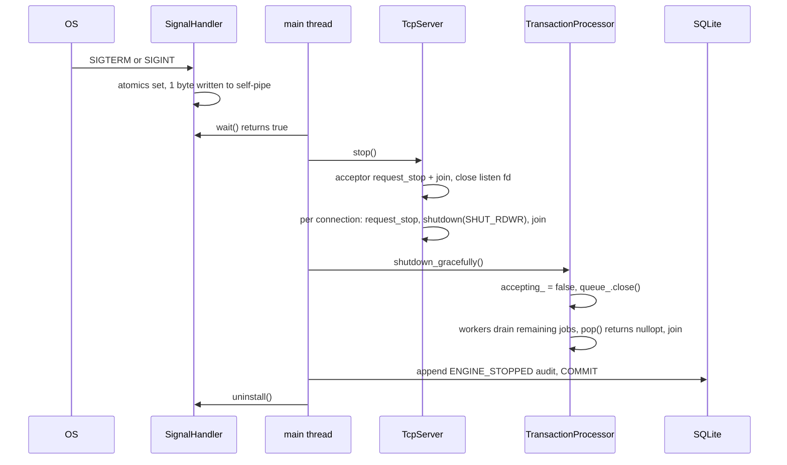

# Concurrency

This document describes the threads that exist inside a running engine, the shared state they touch and how each piece is protected, the lock ordering that keeps the engine deadlock-free, how the in-process locks relate to SQLite's own locking, the graceful shutdown sequence, and what the test suite and ThreadSanitizer actually verify.

Related documents: [ARCHITECTURE.md](ARCHITECTURE.md), [IDEMPOTENCY.md](IDEMPOTENCY.md), [PERSISTENCE.md](PERSISTENCE.md), [TESTING.md](TESTING.md), [ADR-0003](ADR/0003-locking-strategy.md).

## Threads in the process

In `corebank serve` (`src/cli/commands_serve.cpp`) the following threads exist. Single-command CLI invocations (`corebank transfer ...`) use only the main thread: no processor, no server.

| Thread | Count | Created by | Work loop |
| --- | --- | --- | --- |
| main | 1 | OS | Wires the services, then loops on `SignalHandler::wait(500ms)` until SIGTERM or SIGINT; runs the shutdown sequence. |
| acceptor | 1 | `TcpServer::start` (`std::jthread`) | `accept_loop`: `poll()` on the listening socket in 100 ms slices, `accept()`, enforce `max_connections`, spawn a connection thread, reap finished ones. |
| connection | up to `max_connections` | acceptor | `serve_connection`: `poll()` in 100 ms slices, idle timeout, `recv()`, split on `\n`, call `MessageHandler::handle` synchronously, write the response, enforce `max_line_bytes`. |
| worker | `worker_count` | `TransactionProcessor::start` (`std::jthread`) | `worker_loop`: `BoundedQueue::pop(stop_token)`, dispatch the request to `TransactionService`, fulfil the job's `std::promise`. |

A connection thread blocks inside `MessageHandler::await` for up to `request_timeout_ms` while a worker processes its financial request; non-financial messages (`PING`, `BALANCE`, `TXN_GET`, `ACCOUNT_CREATE`) run on the connection thread itself. All threads are `std::jthread`, so every one has a `std::stop_token` and is joined on destruction.

## Shared state and its protection

| Shared state | Owner | Protection |
| --- | --- | --- |
| `BoundedQueue::items_`, `closed_` | `TransactionProcessor` | `std::mutex` plus two `std::condition_variable_any` (`not_empty_`, `not_full_`), waited with a `stop_token` so a stop request wakes blocked consumers. |
| `accepting_`, `started_`, the four counters | `TransactionProcessor` | `std::atomic`; counters use `memory_order_relaxed`. |
| `workers_` vector | `TransactionProcessor` | Mutated only by `start()` and the shutdown functions. In `cmd_serve` those run on the main thread before the server starts and after `server.stop()` has joined every connection thread. |
| `IdempotencyGate::in_flight_` | `TransactionService` | `std::mutex` plus `std::condition_variable released_`; the RAII `Token` erases the key and calls `notify_all`. |
| `AccountLockManager::stripes_` | `TransactionService` | 64 `std::shared_mutex` held through `std::unique_ptr` (stable addresses); the vector is immutable after construction. |
| `TransactionService::business_date_override_` | `TransactionService` | Not synchronised. Set once in `Context::open_database` before any worker or server thread exists. |
| Connection pool `pool_`, `outstanding_` | `SqliteRepository` | `std::mutex pool_mutex_` plus `std::condition_variable pool_available_`; `acquire` blocks until a connection is free. |
| `SqliteRepository::fault_` | repository | `std::atomic<Fault>` (test-only). |
| `sqlite3*` handles | pool | Opened with `SQLITE_OPEN_NOMUTEX`; each handle is owned by exactly one `SqliteUnitOfWork` at a time, so no two threads touch one handle concurrently. |
| `TcpServer::connections_` | server | `std::mutex connections_mutex_`; each `Connection::done` is `std::atomic<bool>`; `running_`, `total_` are atomic. |
| `Logger` level, sink, file | process singleton | `std::mutex` around every `log()` call and setter. |
| `IdGenerator::engine_`, `counter_` | shared by all services | `std::mutex` for the `std::mt19937_64`; `std::atomic<std::uint64_t>` counter. |
| `SignalHandler` globals | process | `std::atomic<int>` and `std::atomic<bool>`; the handler executes only atomic stores and `write(2)`. |
| `Transaction`, `Account`, `Posting` values | per request | Stack-local to the worker handling the request; never shared between threads. |

## Lock ordering

`TransactionService::execute` in `src/application/transaction_service.cpp` carries the rule as a comment and follows it literally:

```cpp
// Lock order (never varied): idempotency gate -> account stripes -> database write txn.
```

The full sequence for a financial request:

1. Validate the request shape (amount, limit, source != destination). No locks held.
2. Acquire the idempotency gate token for the key. Blocks while another thread processes the same key.
3. Open a read-only unit of work (a pooled connection, `BEGIN DEFERRED`), check for a stored outcome, and release it. No stripes held yet.
4. Acquire the account stripes exclusively, in ascending stripe index, de-duplicated.
5. Open a read-write unit of work: take the repository's in-process writer mutex (`SqliteRepository::writer_mutex()`), then a pooled connection, then `BEGIN IMMEDIATE`, which takes SQLite's write lock up front. The writer mutex makes other writers block on a condition variable in the kernel instead of retrying inside SQLite's busy handler; readers never take it.
6. Commit or roll back (which releases the writer mutex), then release stripes, then release the token (reverse order of acquisition through RAII destructors).

`TransactionService::reverse` acquires the token itself, performs its replay check and the lookup of the original with read-only units of work, and then calls `execute`, which skips the gate for `REVERSAL` plans so the token is held exactly once. `account_history` takes a single shared stripe lock and then a read-only unit of work; other queries take no stripes.

### Deadlock-freedom argument

Give every lockable resource a rank: gate token (rank 0), stripe `i` (rank `1 + i`), writer mutex (rank 65), pool connection (rank 66), SQLite write lock (rank 67). Every thread acquires resources in strictly increasing rank, and whenever it needs a resource of lower rank again it has already released everything above it:

- A thread holds at most one gate token at a time (`reverse` acquires one, `execute` acquires one only for non-reversal plans). Token holders never wait for another token.
- `lock_exclusive` is called once per request with the complete account set, sorts the stripe indices, removes duplicates, and locks in that order. A thread holding stripes never asks for more stripes. The shared lock in `account_history` is a single stripe.
- The pooled connection used for the replay check in step 3 is released before step 4, so a thread never holds a connection while waiting for stripes. A thread never holds two connections.
- The writer mutex is requested only after all stripes are held, and the SQLite write lock only after the writer mutex. Their holder waits for nothing of lower rank (it already has its stripes and connection), so it always finishes and releases. Read-only units of work skip the writer mutex entirely (`BEGIN DEFERRED`), so readers never queue behind a writer at this level.

With acquisition in increasing rank there can be no cycle in the wait-for graph, hence no deadlock. SQLite's `busy_timeout` (5000 ms) additionally bounds the wait on the write lock and converts a pathological wait into a `PersistenceError` rather than a hang. `tests/concurrency/deadlock_test.cpp` exercises opposite-direction transfers over a ring of four accounts from eight threads with a hard 120 second deadline.

## Striped account locks

`AccountLockManager` (`src/application/account_lock_manager.cpp`) maps an account id to one of `kDefaultStripes = 64` `std::shared_mutex` instances:

```cpp
std::size_t AccountLockManager::stripe_of(const AccountId& id) const noexcept {
  return std::hash<std::string>{}(id.str()) % stripes_.size();
}
```

Trade-offs of striping versus a per-account lock map:

| Aspect | Striped (as implemented) | Per-account map (not implemented) |
| --- | --- | --- |
| Memory | Fixed: 64 mutexes regardless of account count. | Grows with the number of accounts ever touched; needs eviction or weak references. |
| Collisions | Two unrelated accounts that hash to the same stripe serialise unnecessarily (false sharing). With 64 stripes, a random pair collides with probability about 1 in 64. | None. |
| Lock acquisition | Sort and de-duplicate at most two indices per request. | Look up or insert map entries under a global mutex. |
| Correctness | Identical: the same account always maps to the same stripe, so two writers on one account always contend. | Identical. |

Because SQLite admits one writer at a time anyway, stripe collisions change the order in which writers queue, not the achievable throughput. The stripe count is a constructor argument, so a different value can be chosen without touching callers.

### Why hold in-process locks when SQLite already serialises writers

`BEGIN IMMEDIATE` makes every read-write unit of work exclusive at the database level, so the read-check-write sequence inside `post` is already isolated from other writers. The stripes add three things:

1. Threads touching different accounts still queue for the single writer slot (the writer mutex, then SQLite's lock), but threads touching the same account queue on the stripe first, in a defined order.
2. Readers of an account's history (`account_history`) use the shared side of the stripe and therefore never observe a balance while a write to that account is between its postings and its commit.
3. The stripes are the component that carries over to a database with row-level locking, where multiple writers proceed concurrently and in-process ordering becomes load-bearing.

The optimistic version check in `update_account_balance` (`WHERE account_id = ? AND version = ?`, then `changes() == 1`) is defence in depth under SQLite: the single-writer lock prevents another writer from changing the row between the read and the update inside one `BEGIN IMMEDIATE` transaction. It becomes the primary guard on an engine with row locks. See [PERSISTENCE.md](PERSISTENCE.md).

## Back-pressure and the worker pool

`TransactionProcessor::submit` never blocks indefinitely:

```cpp
if (!queue_.try_push_for(job, options_.enqueue_timeout)) {
  rejected_queue_full_.fetch_add(1, std::memory_order_relaxed);
  job->promise.set_value(make_error(ErrorCode::QueueFull, "request queue is full"));
}
```

The queue capacity is `queue_size` (default 1024) and the enqueue timeout is 200 ms in `cmd_serve`. When the processor is not accepting, `submit` resolves the future immediately with `ShuttingDown`. Workers pop with a stop token, so `shutdown_now` can wake a blocked worker even when the queue is empty.

## Graceful shutdown sequence



Details worth knowing:

- Connection threads notice the stop request at the next 100 ms poll slice, except while blocked in `MessageHandler::await`; in that case they finish the current request (bounded by `request_timeout_ms`) and then exit, so `server.stop()` may take up to that long.
- By the time `shutdown_gracefully` runs, no connection thread exists, so nothing can call `submit` and nothing new enters the queue. Every job already queued is processed to completion and every future is resolved; `fail_pending` runs afterwards as a safety net in case a promise remained.
- `shutdown_now` (used by the destructor and when `server.start()` fails) closes the queue, fails every queued job with `ShuttingDown`, requests stop on the workers and joins them. A job that a worker had already dequeued still completes.
- `TcpServer::stop` and `TransactionProcessor::shutdown_*` are idempotent.

## What the tests prove

| Test | Property |
| --- | --- |
| `tests/unit/lock_manager_test.cpp` | Stripe mapping is stable, duplicate stripes are merged, overlapping exclusive sets never run concurrently (`max_inside == 1`), shared locks coexist and exclude writers. |
| `tests/unit/bounded_queue_test.cpp` | FIFO within capacity, `try_push_for` times out without moving from the item, `pop` wakes on stop request, `close` drains then returns `nullopt`, every item is consumed exactly once with 4 producers and 3 consumers. |
| `tests/concurrency/concurrent_transfers_test.cpp` | Eight threads hammering one hub account post every transfer and balances match; opposite-direction transfers conserve the total; a randomised six-account mesh keeps the total, never goes negative and agrees with the posting journal. |
| `tests/concurrency/concurrent_idempotency_test.cpp` | Twelve threads with the same key and request produce one transaction id and eleven replays, and the gate is empty afterwards; eight conflicting requests under one key produce one commit and seven `IDEMPOTENCY_CONFLICT` errors. |
| `tests/concurrency/deadlock_test.cpp` | Eight threads over a ring of four accounts complete 800 transfers within the deadline; a tight reader loop does not stop 50 writes from completing. |
| `tests/concurrency/processor_test.cpp` | Work runs on worker threads; submit after shutdown fails fast; a full queue yields `QUEUE_FULL`; graceful shutdown drains queued work; the destructor resolves pending promises with `SHUTTING_DOWN`. |
| `tests/messaging/signal_test.cpp` | A raised SIGTERM wakes the waiter; the end-to-end sequence (server stop, processor drain) posts all 60 queued transfers. |
| `tests/messaging/tcp_server_test.cpp` | Concurrent clients are served, the connection limit is enforced, `stop` closes clients and is idempotent. |

## What ThreadSanitizer covers

The CI workflow (`.github/workflows/ci.yml`) has a dedicated `thread-sanitizer` job that configures with `COREBANK_ENABLE_TSAN=ON` and runs the `unit`, `concurrency`, `messaging`, `property` and `integration` labels with `TSAN_OPTIONS=halt_on_error=1:second_deadlock_stack=1`. The `batch` and `cli` labels are not run under TSan; the CLI tests drive a separate process. A separate job runs the whole suite under ASan and UBSan.

TSan detects unsynchronised accesses and reports lock-order inversions it observes; it does not prove the absence of deadlocks in interleavings the tests never reach. The ordering argument above is the justification for those cases, and `deadlock_test.cpp` is the executable check.

## Known limits

- The gate and the stripes are per process. Two engine processes on one database are coordinated only by SQLite's write lock and the `idempotency_records` primary key (see [IDEMPOTENCY.md](IDEMPOTENCY.md)).
- `std::shared_mutex` makes no fairness promise; a sustained stream of readers on one stripe could delay a writer. The test checks progress, not latency bounds.
- A request that times out at the protocol level is still processed by a worker; the client must retry with the same key rather than a new one.
