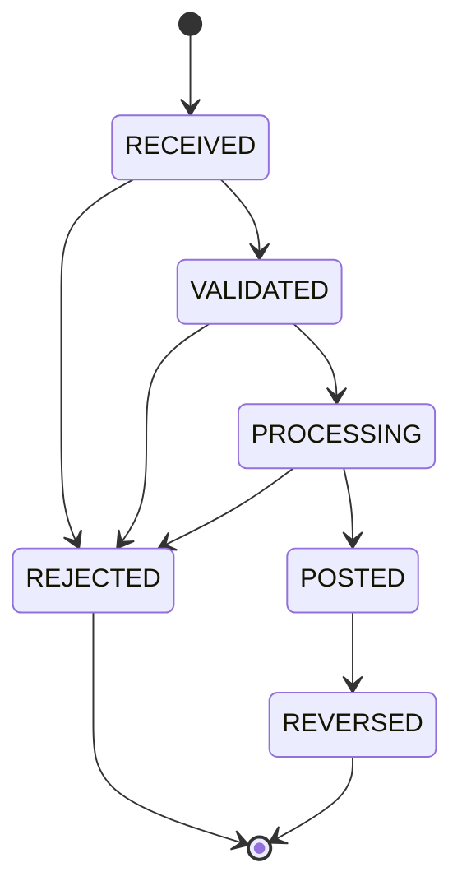

# Domain Model

The domain layer (`include/corebank/domain/`, `src/domain/`) holds the types that give the engine its meaning: money, identifiers, accounts, transactions, postings, audit events, batch records and reconciliation results. It depends on the C++ standard library only; there is no SQLite, networking or threading code in it. Every type is a plain value or aggregate with explicit validation, and every fallible operation returns `Result<T>` rather than throwing.

Related documents: [ARCHITECTURE.md](ARCHITECTURE.md), [IDEMPOTENCY.md](IDEMPOTENCY.md), [PERSISTENCE.md](PERSISTENCE.md), [ADR-0002](ADR/0002-money-representation.md), [ADR-0007](ADR/0007-error-handling.md).

## Result and Error

`include/corebank/domain/result.hpp` defines a minimal expected-like type for C++20 (the project does not use `std::expected`, which is C++23):

```cpp
template <typename T>
class [[nodiscard]] Result {
  ...
  std::variant<T, Error> storage_;
};
```

`Result<void>` is specialised over `std::optional<Error>`. Both offer `has_value()`, `has_error()`, `explicit operator bool`, `value()`, `error()`, and `Result<T>` adds `value_or`, `and_then` and `map`. `ok()` returns a successful `Result<void>`.

`Error` is `{ErrorCode code; std::string message;}`. `ErrorCode` (`include/corebank/domain/error.hpp`) is grouped into validation, domain outcome, batch, infrastructure and messaging codes, each with an upper-case text form in `src/domain/error.cpp` (`INVALID_AMOUNT`, `INSUFFICIENT_FUNDS`, `IDEMPOTENCY_CONFLICT`, `PERSISTENCE_ERROR`, and so on). That text is what reaches the wire protocol, JSON output and the `rejection_code` column.

## Money and CurrencyCode

`Money` (`include/corebank/domain/money.hpp`) is an exact amount: a signed 64-bit count of minor units plus a `CurrencyCode`. There are no floating-point values anywhere in the money path.

| Aspect | Rule | Source |
| --- | --- | --- |
| Representation | `std::int64_t minor_` + `CurrencyCode currency_` | `money.hpp` |
| Arithmetic | `add`, `subtract`, `negated`, `multiply` are overflow-checked with `__builtin_add_overflow`, `__builtin_sub_overflow`, `__builtin_mul_overflow`; overflow yields `ErrorCode::Overflow` | `src/domain/money.cpp` |
| Currency safety | `add`, `subtract` and `compare` return `CurrencyMismatch` when currencies differ; `operator==` compares both fields | `money.cpp` |
| Parsing | `Money::parse("1250.00", GBP)`: optional sign, required integer part, optional fraction with at most `minor_units()` digits, no exponent notation, overflow-checked scaling | `money.cpp` |
| Formatting | `format_amount()` gives `"1250.00"` (zero-padded to the currency exponent, no fraction for exponent 0); `to_string()` appends the code, `"1250.00 GBP"` | `money.cpp` |

`CurrencyCode` is a three-letter code with a minor-unit exponent, taken from a fixed table in `src/domain/currency.cpp`:

| Code | Exponent |
| --- | --- |
| GBP, USD, EUR, IDR, SGD, CHF, AUD | 2 |
| JPY | 0 |

`CurrencyCode::parse` requires exactly three upper-case letters present in that table; anything else is `InvalidCurrency`. Adding a currency is a one-line change to `kCurrencies`.

## Identifiers and JournalReference

`Identifier<Tag>` (`include/corebank/domain/identifiers.hpp`) is a strongly typed string so that an `AccountId` cannot be passed where a `TransactionId` is expected. Each tag carries an `IdentifierPolicy`:

| Alias | Max length | Extra characters allowed beyond `[A-Za-z0-9]` |
| --- | --- | --- |
| `AccountId` | 64 | `-_.` |
| `TransactionId` | 64 | `-_.` |
| `BatchId` | 64 | `-_.` |
| `IdempotencyKey` | 128 | `-_.:` |

`validate_identifier` in `src/domain/identifiers.cpp` rejects empty text, text over the limit, a non-alphanumeric first character, and any character outside the policy. `Identifier::unchecked` exists for engine-generated values.

`JournalReference` is free narrative text attached to a transaction: at most 140 characters (`kMaxLength`), printable characters only, and never `|`, `\n` or `\r`, so it can be embedded in the line protocol and in the idempotency signature without escaping. An empty reference is valid.

## Account

```cpp
struct Account {
  AccountId id;
  std::string name;
  AccountType type{AccountType::Customer};
  Money balance;
  bool allow_overdraft{false};
  AccountStatus status{AccountStatus::Active};
  std::int64_t version{0};
  Timestamp created_at;
  Timestamp updated_at;
  ...
};
```

Invariants and rules:

- `name` is 1 to 100 printable characters and never contains `|` (`validate_account_name`).
- The account's currency is the currency of its balance (`currency()`), fixed at creation; the balance starts at zero.
- `version` is the optimistic-concurrency counter incremented by every balance update (see [PERSISTENCE.md](PERSISTENCE.md)).
- `balance_after_debit(amount)` returns, in order of checking: `AccountInactive` when status is not ACTIVE, `CurrencyMismatch`, `Overflow`, then `InsufficientFunds` when the result would be negative and `allow_overdraft` is false. `balance_after_credit` applies the first three checks only.
- The schema enforces the overdraft rule a second time: `CHECK (allow_overdraft = 1 OR balance_minor >= 0)`.

### Account types

| Type | Intended meaning |
| --- | --- |
| `CUSTOMER` | An account held on behalf of a customer. |
| `SETTLEMENT` | An internal account used to settle against external systems. |
| `FEE_INCOME` | An internal account that accumulates fees. |
| `SUSPENSE` | A holding account for items awaiting classification. |

The type is validated on input (`parse_account_type`) and by the `accounts.account_type` CHECK constraint, and it appears in output and audit detail. The engine does not currently apply different posting rules per type: every account is debited and credited by the same `balance_after_*` logic. The distinction is descriptive and available for reporting.

### Account status

`ACTIVE`, `FROZEN` and `CLOSED` are parsed and persisted, and any non-ACTIVE account rejects debits and credits with `AccountInactive`. No service method or CLI command changes an account's status; accounts are created ACTIVE and there is no freeze or close operation in this version.

## Transaction

```cpp
struct Transaction {
  TransactionId id;
  TransactionType type{TransactionType::Transfer};
  TransactionStatus status{TransactionStatus::Received};
  Money amount;
  std::optional<AccountId> source;       // debited account (DEBIT, TRANSFER)
  std::optional<AccountId> destination;  // credited account (CREDIT, TRANSFER)
  JournalReference reference;
  std::optional<IdempotencyKey> idempotency_key;
  std::optional<TransactionId> reversal_of;
  std::optional<TransactionId> reversed_by;
  std::optional<Error> rejection;
  BusinessDate business_date;
  Timestamp created_at;
  Timestamp updated_at;
  ...
};
```

`amount` is always positive once a request has passed `TransactionService::validate_amount` (greater than zero and at most `ServiceLimits::max_transaction_minor`); the schema repeats this with `CHECK (amount_minor > 0)`.

### Transaction types and their legs

Each leg becomes one `Posting`. `source` is always the debited side and `destination` the credited side.

| Type | `source` (DEBIT leg) | `destination` (CREDIT leg) | Postings when posted |
| --- | --- | --- | --- |
| `CREDIT` | none | the account | 1 |
| `DEBIT` | the account | none | 1 |
| `TRANSFER` | source account | destination account | 2, equal amounts |
| `REVERSAL` | original `destination` | original `source` | 1 or 2, mirroring the original |

A `TRANSFER` with identical source and destination is rejected before anything is persisted (`SameAccountTransfer`). A `REVERSAL` is built in `TransactionService::reverse` by swapping the legs of the original and setting `reversal_of`; on success the original receives `reversed_by` and moves to `REVERSED`. The original must be `POSTED` and must not itself be a `REVERSAL`.

### State machine



`can_transition` in `src/domain/transaction.cpp` is the single source of truth:

```cpp
bool can_transition(TransactionStatus from, TransactionStatus to) noexcept {
  switch (from) {
    case TransactionStatus::Received:
      return to == TransactionStatus::Validated || to == TransactionStatus::Rejected;
    case TransactionStatus::Validated:
      return to == TransactionStatus::Processing || to == TransactionStatus::Rejected;
    case TransactionStatus::Processing:
      return to == TransactionStatus::Posted || to == TransactionStatus::Rejected;
    case TransactionStatus::Posted:
      return to == TransactionStatus::Reversed;
    case TransactionStatus::Rejected:
    case TransactionStatus::Reversed:
      return false;
  }
  return false;
}
```

`Transaction::transition_to` applies the move and stamps `updated_at`, or returns `InvalidTransition` without mutating. `Transaction::reject` transitions to `REJECTED` and stores the reason in `rejection`. `is_terminal` is true for `REJECTED` and `REVERSED`. The storage layer mirrors the terminal rule with the trigger `trg_transactions_terminal` (see [PERSISTENCE.md](PERSISTENCE.md)). `tests/unit/state_machine_test.cpp` checks the full matrix.

In normal operation `VALIDATED` and `PROCESSING` are passed through in memory inside one unit of work: `TransactionService::post` inserts the row as `RECEIVED` and writes it again only when it reaches `POSTED` or `REJECTED`, all within the same database transaction. The intermediate statuses are therefore not durably observable unless a row is written by other means.

### Meaning of each status

| Status | Meaning |
| --- | --- |
| `RECEIVED` | Accepted by the service, identity assigned, audit `TRANSACTION_RECEIVED` written. |
| `VALIDATED` | Structural checks passed: every involved account exists, is ACTIVE and matches the currency. |
| `PROCESSING` | Balance checks and postings in progress. |
| `POSTED` | All legs applied, balances updated, idempotency record stored. |
| `REJECTED` | A business rule failed (`INSUFFICIENT_FUNDS`, `ACCOUNT_NOT_FOUND`, `ACCOUNT_INACTIVE`, `CURRENCY_MISMATCH`, `OVERFLOW`, `INVALID_REVERSAL`). The row, an audit event and an idempotency record are kept; no postings exist. |
| `REVERSED` | A later `REVERSAL` transaction was posted against it; `reversed_by` points to it. The original postings are untouched. |

## Posting

```cpp
struct Posting {
  std::int64_t id{0};  // assigned by persistence
  TransactionId transaction_id;
  AccountId account_id;
  PostingDirection direction{PostingDirection::Credit};
  Money amount;
  std::int64_t balance_after_minor{0};
  Timestamp created_at;
};
```

A posting is one immutable journal leg. `balance_after_minor` records the account balance immediately after the leg was applied, which lets reconciliation compare the latest posting with the stored balance (`posting_chain_balance_after` check). `signed_minor(posting)` returns `+amount` for CREDIT and `-amount` for DEBIT, so summing an account's postings reproduces its balance. Postings exist only for transactions that reached `POSTED` (and remain after `REVERSED`); the database forbids updating or deleting them.

## Effective transactions

For totals and consistency checks, a transaction is *effective* when its status is `POSTED` or `REVERSED`. Both have postings that moved money; a reversal does not remove the original's postings, it adds compensating ones. This definition is applied in two places:

- `currency_totals` in `src/infrastructure/sqlite/sqlite_repository.cpp` counts and sums amounts `WHERE status IN ('POSTED','REVERSED')`, and reports `rejected_count` and `reversed_count` separately.
- `ReconciliationService::run_in` (`src/application/reconciliation_service.cpp`) requires effective transactions to carry the legs their type implies (one for CREDIT and DEBIT, two for TRANSFER, one or two for REVERSAL) and non-effective ones to carry none.

## AuditEvent

```cpp
struct AuditEvent {
  std::int64_t id{0};
  Timestamp occurred_at;
  AuditEventType type{AuditEventType::AccountCreated};
  std::string entity_type;  // "account", "transaction", "batch", "engine"
  std::string entity_id;
  std::string detail;  // compact JSON object
  std::optional<BatchId> batch_id;
};
```

Events are appended inside the unit of work that performs the change, so they commit or roll back with it. The table is append-only at the storage level.

| Event type | Entity | Emitted by |
| --- | --- | --- |
| `ACCOUNT_CREATED` | account | `TransactionService::create_account` |
| `TRANSACTION_RECEIVED` | transaction | `TransactionService::post`, first statement after the insert |
| `TRANSACTION_POSTED` | transaction | `TransactionService::post` |
| `TRANSACTION_REJECTED` | transaction | `TransactionService::record_rejection`; also `EodService` when stale pending transactions are rejected at cutoff |
| `TRANSACTION_REVERSED` | transaction (the original) | `TransactionService::post` when a REVERSAL posts |
| `RECONCILIATION_RUN` | reconciliation | `ReconciliationService::run` and the EOD reconciliation stage |
| `BATCH_STARTED`, `BATCH_RESUMED` | batch | `EodService::open_or_resume` |
| `BATCH_STAGE_STARTED`, `BATCH_STAGE_COMPLETED`, `BATCH_STAGE_FAILED` | batch | `EodService::run_stage` |
| `BATCH_COMPLETED`, `BATCH_FAILED` | batch | `EodService::run_stage` |
| `ENGINE_STARTED`, `ENGINE_STOPPED` | engine | `cmd_serve` in `src/cli/commands_serve.cpp` |

Fifteen types in total; `src/domain/audit.cpp` keeps the exhaustive list in `kAllTypes`.

## Batch records

`include/corebank/domain/batch.hpp` defines the end-of-day pipeline's data. `BatchStage` has eight ordered values (`kBatchStages`): `Precheck`, `TransactionCutoff`, `ValidatePending`, `BalanceCheck`, `Reconciliation`, `DailySummary`, `Archive`, `Complete`. A `BatchRun` has a `BatchStatus` (`RUNNING`, `FAILED`, `COMPLETED`), an attempt counter, the current stage, a cutoff timestamp and a vector of `BatchStageRecord` (`PENDING`, `RUNNING`, `COMPLETED`, `FAILED`, with attempts and detail). `DailySummary` is one row per business date and currency with posted, rejected and reversed counts and credit, debit and transfer totals in minor units. The pipeline itself is documented in [EOD_BATCH.md](EOD_BATCH.md) and [ADR-0006](ADR/0006-eod-restart-model.md).

## Reconciliation results

`ReconciliationResult` (`include/corebank/domain/reconciliation.hpp`) is a list of named `ReconciliationCheck` entries (`name`, `passed`, `detail`) plus `CurrencyTotal` rows, with `passed` true only when every check passed. The checks produced by `ReconciliationService::run_in` are: `account_balance_vs_postings`, `posting_chain_balance_after`, `overdraft_policy`, `journal_consistency`, `transfer_double_entry`, `idempotency_links` and `storage_integrity`.

## Time

`Timestamp` is `std::chrono::sys_time<std::chrono::microseconds>` (UTC), formatted as ISO-8601 `YYYY-MM-DDTHH:MM:SS.ffffffZ`. `BusinessDate` is the calendar day (`YYYY-MM-DD`) a transaction belongs to for batch purposes, derived from the clock unless overridden. `Clock` is an abstract interface with a `SystemClock` implementation; services take `const Clock&` so tests can freeze time.
