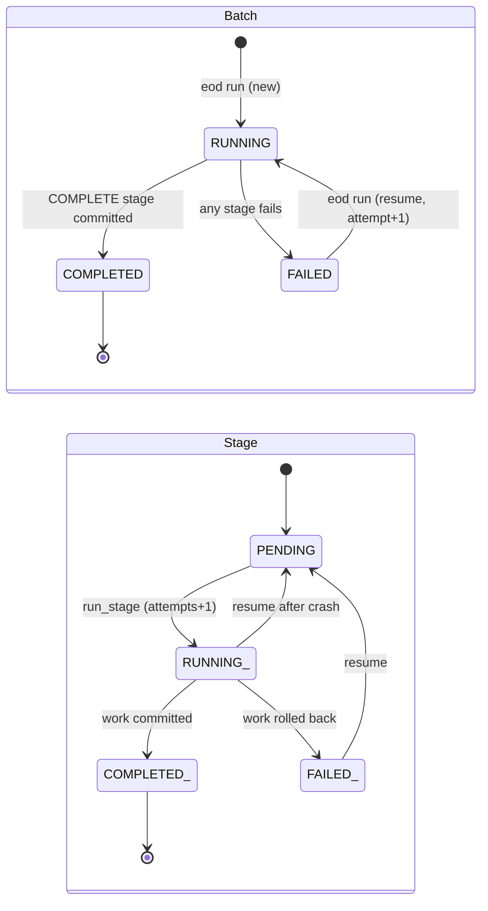

# End-of-Day Batch

This document describes the synthetic end-of-day (EOD) batch implemented in
`src/batch/eod_service.cpp` and `include/corebank/batch/eod_service.hpp`. The batch is an
educational model of a daily close: it cuts off the business date, validates the ledger,
reconciles it, writes a per-currency summary and exports the day's transactions. It operates
on synthetic data only and uses generic banking concepts; no real institution's close
procedure is represented.

Related documents: [ARCHITECTURE.md](ARCHITECTURE.md), [PERSISTENCE.md](PERSISTENCE.md),
[OPERATIONS.md](OPERATIONS.md), [SHELL_AUTOMATION.md](SHELL_AUTOMATION.md),
[ADR-0006 EOD restart model](ADR/0006-eod-restart-model.md),
[ADR-0007 error handling](ADR/0007-error-handling.md).

## Purpose

The batch exists to demonstrate three properties that any daily control process needs:

| Property | Meaning here | Where it is enforced |
| --- | --- | --- |
| Idempotency | Running `eod run` twice for the same date does not repeat work | `EodService::run`, `already_completed` |
| Restartability | A failed or interrupted batch resumes from the first incomplete stage | `EodService::open_or_resume`, `run_stage` |
| Auditability | Every start, resume, stage transition and failure is an append-only audit event | `EodService::audit`, `audit_events` table |

Online transaction processing is not blocked by the batch. The demo (`scripts/demo.sh`)
stops the engine before running EOD, but the service itself only checks that no other
batch is `RUNNING`.

## Business date

The business date is the UTC calendar date taken from the clock unless overridden. The
override comes from `--business-date YYYY-MM-DD` on the CLI or the `COREBANK_BUSINESS_DATE`
environment variable (`business_date` configuration key, `src/infrastructure/config.cpp`).
`eod run --date` selects the date for a specific run and takes precedence for that command
(`src/cli/commands_ops.cpp`, `cmd_eod`).

## Stage pipeline

The stages run in the fixed order of `kBatchStages` (`include/corebank/domain/batch.hpp`).


| Stage | Purpose | Inputs | Outputs | Fails when |
| --- | --- | --- | --- | --- |
| `PRECHECK` | Confirm the environment can run a batch | `PRAGMA quick_check`, latest batch row, `batch_dir` | None (directory created if missing) | Integrity result is not `ok`; another batch is `RUNNING`; `batch_dir` cannot be created |
| `TRANSACTION_CUTOFF` | Freeze the cutoff timestamp | Clock, transactions dated the business date | `cutoff_at` on the batch row; detail with the transaction count | Transaction query fails |
| `VALIDATE_PENDING` | Reject stale non-terminal transactions | Pending transactions created before `cutoff_at - stale_pending_after` | Transactions moved to `REJECTED` with code `TIMEOUT`; a `TRANSACTION_REJECTED` audit event per transaction | Status update or audit write fails |
| `BALANCE_CHECK` | Stored balances agree with postings and overdraft policy | Accounts, `posting_totals_by_account` | Detail with the number of verified accounts | Any balance mismatch or negative balance without `allow_overdraft` |
| `RECONCILIATION` | Full ledger reconciliation inside the batch transaction | `ReconciliationService::run_in` (7 checks) | `RECONCILIATION_RUN` audit event with `passed`, `checks`, `failed` | Any check fails (`ReconciliationFailed`) |
| `DAILY_SUMMARY` | Per-currency totals for the day | `currency_totals(business_date)` | Rows upserted into `daily_summaries`; `<batch_dir>/<date>/daily_summary.json` | Upsert or file write fails |
| `ARCHIVE` | Export the day's transactions | Transactions dated the business date | `<batch_dir>/<date>/transactions.csv` (nothing deleted) | Query or file write fails |
| `COMPLETE` | Mark the batch finished | Batch row | Status `COMPLETED`, `completed_at`, `BATCH_COMPLETED` audit event | Persist or commit fails |

`stale_pending_after` is 60 seconds when the service is constructed by the CLI
(`src/cli/app.cpp`, `Context::open_database`). The reconciliation checks themselves are
`account_balance_vs_postings`, `posting_chain_balance_after`, `overdraft_policy`,
`journal_consistency`, `transfer_double_entry`, `idempotency_links` and
`storage_integrity` (`src/application/reconciliation_service.cpp`).

## Run semantics

`EodService::run(date)` behaves as follows.

1. In a read-only transaction it loads the latest batch for the date. If that batch is
   `COMPLETED` it logs `eod.already_completed` and returns with `already_completed = true`.
   Nothing is written.
2. Otherwise `open_or_resume` runs in a read-write transaction:
   * No batch for the date: insert a new `BatchRun` with `attempt = 1`, every stage
     `PENDING`, and append `BATCH_STARTED`.
   * A `FAILED` or `RUNNING` batch exists: keep the same `batch_id`, increment `attempt`,
     clear `failure_reason`, reset every `RUNNING` or `FAILED` stage to `PENDING`, keep
     `COMPLETED` stages untouched, and append `BATCH_RESUMED` with `attempt` and
     `stages_reset`.
3. For each stage in order: skip it if already `COMPLETED` (log `eod.stage_skipped`),
   otherwise call `run_stage`. If the batch status becomes `FAILED`, return an error with
   code `BatchStageFailed` naming the stage and the failure reason.

### Stage execution and transaction boundaries

Each stage uses two committed transactions plus, on failure, a third.

```mermaid
sequenceDiagram
    participant S as EodService
    participant DB as SQLite
    S->>DB: BEGIN (1)
    S->>DB: stage=RUNNING, attempts+1, current_stage; audit BATCH_STAGE_STARTED
    S->>DB: COMMIT (1)
    S->>DB: BEGIN (2)
    S->>DB: stage work (queries, updates, files)
    alt work succeeds
        S->>DB: stage=COMPLETED (+ batch COMPLETED on COMPLETE); audit BATCH_STAGE_COMPLETED
        S->>DB: COMMIT (2)
    else work fails
        S->>DB: ROLLBACK (2)
        S->>DB: BEGIN (3)
        S->>DB: stage=FAILED, batch=FAILED, failure_reason; audit BATCH_STAGE_FAILED, BATCH_FAILED
        S->>DB: COMMIT (3)
    end
```

The first commit leaves durable evidence that the stage started, so a crash mid-stage is
visible as a `RUNNING` stage and is re-run (not skipped) on restart. The work and the
`COMPLETED` status are committed together, so a stage can never be marked complete while its
side effects are missing from the database. File outputs (`daily_summary.json`,
`transactions.csv`) are written during the work transaction; if the subsequent commit fails
the files may exist while the stage remains incomplete, and the restart rewrites them.

### Status model



Statuses are enforced by `CHECK` constraints on `batch_runs` and `batch_stages`
(`src/infrastructure/sqlite/schema.cpp`).

## Audit events

| Event | When | Detail fields |
| --- | --- | --- |
| `BATCH_STARTED` | New batch opened | `business_date` |
| `BATCH_RESUMED` | Existing non-completed batch reopened | `attempt`, `stages_reset` |
| `BATCH_STAGE_STARTED` | Before stage work | `stage`, `attempt` |
| `BATCH_STAGE_COMPLETED` | With the stage's work commit | `stage`, `detail`, `duration_ms` |
| `BATCH_STAGE_FAILED` | After rollback of a failed stage | `stage`, `code`, `reason` |
| `BATCH_FAILED` | Same transaction as `BATCH_STAGE_FAILED` | `stage`, `code`, `reason` |
| `BATCH_COMPLETED` | With the `COMPLETE` stage commit | `attempt`, `business_date` |
| `RECONCILIATION_RUN` | Inside the `RECONCILIATION` stage | `passed`, `checks`, `failed` |
| `TRANSACTION_REJECTED` | Per stale transaction in `VALIDATE_PENDING` | `code`, `reason`, `batch_id` |

All batch events carry `entity_type = "batch"` and `batch_id`, so
`corebank audit --batch <id>` returns the whole history of a run including failed attempts.
`tests/batch/eod_test.cpp` (`SecondRunForSameDateIsIdempotent`) asserts that a clean run
produces exactly 1 + 2 x 8 + 1 + 1 = 19 batch-scoped events.

## CLI and exit codes

```text
corebank eod run     [--date YYYY-MM-DD]
corebank eod status  [--date YYYY-MM-DD]
corebank eod history [--limit N]
```

| Command | Outcome | Exit code |
| --- | --- | --- |
| `eod run` | Completed, resumed and completed, or already completed | 0 |
| `eod run` | A stage failed (`BatchStageFailed`, `ReconciliationFailed`, `BatchAlreadyRunning`) | 3 |
| `eod run` | Database or configuration error | 4 |
| `eod status` | Latest batch is `RUNNING` or `COMPLETED`, or no batch recorded | 0 |
| `eod status` | Latest batch is `FAILED` | 3 |
| `eod history` | Lists batches, newest first | 0 |

On failure `cmd_eod` prints the recorded batch state (every stage, its status, attempts and
detail) before the error line so the failing stage is visible without a second command.
`--json` prints the same structure as a JSON object (`batch_json` in `src/cli/output.cpp`).

## Failure injection walkthrough

`COREBANK_FAIL_STAGE=<STAGE>` (configuration key `fail_stage`) makes `execute_stage` return
an error before doing any work for that stage. The following sequence uses a throw-away
database and mirrors `tests/cli/cli_test.cpp` (`EodRunStatusAndFailureInjection`).

```bash
export COREBANK_DB=/tmp/eod-demo/corebank.db COREBANK_BATCH_DIR=/tmp/eod-demo/batch
build/corebank account create --id A --name A --currency GBP
build/corebank transaction credit --account A --amount 1 --currency GBP

COREBANK_FAIL_STAGE=ARCHIVE build/corebank eod run --date 2026-10-15
echo "exit=$?"        # exit=3, output shows ARCHIVE FAILED, DAILY_SUMMARY COMPLETED

build/corebank eod status --date 2026-10-15
echo "exit=$?"        # exit=3 while the batch is FAILED

build/corebank eod run --date 2026-10-15
echo "exit=$?"        # exit=0, "batch resumed and completed (attempt 2)"

build/corebank eod run --date 2026-10-15
echo "exit=$?"        # exit=0, "batch already completed for 2026-10-15, nothing to do"

build/corebank audit --type BATCH_RESUMED --limit 5
```

After the resume, `PRECHECK` through `DAILY_SUMMARY` show `attempts=1` and `ARCHIVE` shows
`attempts=2`. `scripts/demo.sh` performs the same exercise with
`COREBANK_FAIL_STAGE=RECONCILIATION`, and `scripts/run_eod.sh` logs a warning when the
variable is set.

`FailureInEveryStageIsRecoverable` in `tests/batch/eod_test.cpp` injects a failure into each
of the eight stages on a separate date and verifies that a second run completes with
`attempt = 2`.

## Output files and permissions

| File | Producer | Content |
| --- | --- | --- |
| `<batch_dir>/<date>/daily_summary.json` | `DAILY_SUMMARY` | `business_date`, `batch_id`, `generated_at`, `currencies[]` with posted, rejected and reversed counts and credit, debit and transfer totals in minor units |
| `<batch_dir>/<date>/transactions.csv` | `ARCHIVE` | Header plus one row per transaction dated that day: id, type, status, currency, amount, source, destination, reference (CSV-escaped), reversal_of, rejection_code, created_at |

`write_file_0640` creates the parent directory, truncates and writes the file, then replaces
its permissions with owner read/write and group read (mode 0640). The archive is an export;
`stage_archive` never deletes rows from the database. The same totals written to the JSON
file are upserted into `daily_summaries` keyed by `(business_date, currency)`, so a re-run
of the stage overwrites rather than duplicates.

## Operational runbook

| Situation | Reading the state | Action |
| --- | --- | --- |
| `eod run` exits 3 | `corebank eod status --date D` shows the `FAILED` stage and `failure:` reason | Fix the cause, then re-run `scripts/run_eod.sh D`; completed stages are skipped |
| `PRECHECK` fails with `storage integrity` | `PRAGMA quick_check` returned something other than `ok` | Stop writers, restore from backup (see [OPERATIONS.md](OPERATIONS.md)), re-run |
| `PRECHECK` fails with `is still RUNNING` | Another batch row is `RUNNING` (for example a different date that crashed) | Re-run that other date first so it resumes and finishes, or inspect it with `eod status --date` |
| `BALANCE_CHECK` or `RECONCILIATION` fails | `corebank reconcile` names the failing check and the first mismatch | Investigate the ledger; the batch does not alter balances, and the archive has not been written yet |
| `DAILY_SUMMARY` or `ARCHIVE` fails with a filesystem error | Detail names the path | Check `batch_dir` ownership and space, re-run |
| A batch is `RUNNING` after a crash | `eod status` shows a `RUNNING` stage | Re-run; the stage is reset to `PENDING` and executed again |
| Batch already `COMPLETED` but output files were removed | `eod run` is a no-op | Files are not regenerated for a completed batch; restore them from the backup of `batch_dir` |

The audit trail is never pruned by a resume: `InjectedFailureIsRecordedAndRestartSkipsCompletedStages`
verifies that the events of the failed attempt remain before the `BATCH_RESUMED` event.

## What is deliberately generic

* There is no interest accrual, fee sweep, general-ledger posting or regulatory report. The
  stage list is a teaching skeleton with one representative control per step.
* The cutoff only records a timestamp and counts transactions; it does not close a
  "business day" that online processing would observe, because the engine's business date
  comes from the clock.
* The archive is a CSV export, not a retention or purge process.
* Stale-pending handling marks transactions `REJECTED` with `TIMEOUT`; there is no retry or
  manual repair queue.
* No scheduler is included; `scripts/run_eod.sh` is intended for cron, systemd timers or a
  manual operator (see [SHELL_AUTOMATION.md](SHELL_AUTOMATION.md)).

See [LIMITATIONS.md](LIMITATIONS.md) for the wider list of simplifications.
