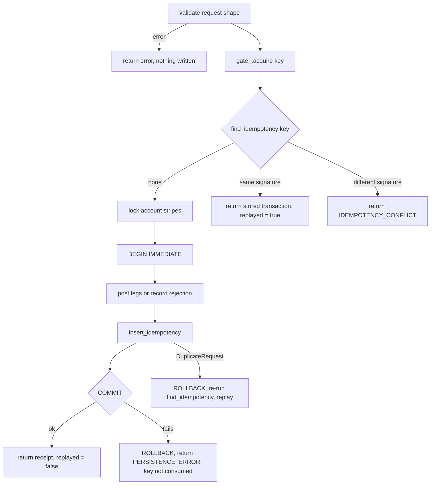

# Idempotency

Every financial request (credit, debit, transfer, reversal) carries an idempotency key. The engine guarantees that a request is applied at most once per key, that a retry returns the original outcome, and that reusing a key for a different request is refused. This document explains the requirements, the mechanism, the storage, the protocol and CLI behaviour, the failure and retry semantics, and the limitations.

Related documents: [CONCURRENCY.md](CONCURRENCY.md), [PERSISTENCE.md](PERSISTENCE.md), [DOMAIN_MODEL.md](DOMAIN_MODEL.md), [ADR-0005](ADR/0005-idempotency-design.md).

## Requirements

| Requirement | Behaviour | Verified by |
| --- | --- | --- |
| Same key, same request | The stored outcome is returned with `replayed = true`; no new transaction, posting or balance change. | `tests/integration/idempotency_test.cpp` `SameKeySameRequestReplaysWithoutReposting` |
| Same key, different request | `ErrorCode::IdempotencyConflict`; nothing is written. | `SameKeyDifferentRequestIsAConflict`, `KeysAreScopedAcrossOperationTypes` |
| Concurrent same key | Exactly one commit; every other caller waits and then replays. | `tests/concurrency/concurrent_idempotency_test.cpp` `ManyThreadsSameKeyCommitExactlyOnce` |
| Concurrent conflicting requests under one key | One commit, the rest conflict. | `ConcurrentConflictingRequestsYieldOneCommitAndConflicts` |
| Rejected outcomes replay too | A business rejection is stored under the key and replayed as `REJECTED`. | `RejectedOutcomesAreReplayedToo` |
| Failed commit does not consume the key | A retry after an infrastructure failure is a fresh attempt, not a replay. | `tests/integration/rollback_test.cpp` `CommitFailureLeavesNoTrace` |

## Keys

`IdempotencyKey` is an `Identifier<IdempotencyKeyTag>` (`include/corebank/domain/identifiers.hpp`): 1 to 128 characters, starting with a letter or digit, drawn from `[A-Za-z0-9]` plus `-`, `_`, `.` and `:`. The key space is global to the database: the same key cannot be used for a credit and then for a debit, even on different accounts (`KeysAreScopedAcrossOperationTypes`). Clients that share a database should prefix their keys to avoid collisions.

## Request signature

To decide whether a retry is "the same request", the service builds a canonical text form of the request and compares it verbatim with the stored one. There is no hashing. The functions live in `src/application/transaction_service.cpp`:

```cpp
std::string request_signature(const CreditRequest& request) {
  return signature_of("CREDIT", "", request.account.str(), request.amount, request.reference.str());
}
std::string request_signature(const DebitRequest& request) {
  return signature_of("DEBIT", request.account.str(), "", request.amount, request.reference.str());
}
std::string request_signature(const TransferRequest& request) {
  return signature_of("TRANSFER", request.source.str(), request.destination.str(), request.amount,
                      request.reference.str());
}
std::string request_signature(const ReverseRequest& request) {
  return "REVERSAL|" + request.original.str() + "||" + request.reference.str();
}
```

`signature_of` joins `TYPE|source|destination|amount ccy|reference` with `|`. Examples:

| Request | Signature |
| --- | --- |
| Credit 10.00 GBP to `CUST-A`, reference `salary` | `CREDIT||CUST-A|10.00 GBP|salary` |
| Debit 2.50 GBP from `CUST-A`, reference empty | `DEBIT|CUST-A||2.50 GBP|` |
| Transfer 100.00 GBP `CUST-A` to `CUST-B`, reference `rent` | `TRANSFER|CUST-A|CUST-B|100.00 GBP|rent` |
| Reverse `TXN-0000000000000001-000003`, reference `undo` | `REVERSAL|TXN-0000000000000001-000003||undo` |

The reference is part of the signature, so retrying the same transfer with a different reference is a conflict. `JournalReference` forbids `|`, which keeps the format unambiguous. The amount is rendered with `Money::to_string()`, so `10.0` and `10.00` parse to the same minor units and produce the same signature.

## Storage

The record type is declared in `include/corebank/application/repository.hpp`:

```cpp
struct IdempotencyRecord {
  IdempotencyKey key;
  std::string request_signature;  // canonical request text, compared verbatim
  TransactionId transaction_id;
  Timestamp created_at;
};
```

It is stored in the `idempotency_records` table (`src/infrastructure/sqlite/schema.cpp`): `idempotency_key TEXT PRIMARY KEY`, `request_signature TEXT NOT NULL`, `transaction_id TEXT NOT NULL REFERENCES transactions(transaction_id)`, `created_at TEXT NOT NULL`. Two triggers (`trg_idempotency_no_update`, `trg_idempotency_no_delete`) make rows immutable. The transaction row also carries the key in `transactions.idempotency_key` for inspection; uniqueness is enforced only by the primary key of `idempotency_records`.

The record is inserted in the same unit of work as the postings and the status update, both on the posted path (`TransactionService::post`) and on the rejected path (`TransactionService::record_rejection`). It therefore commits or rolls back together with the outcome it describes. Reconciliation's `idempotency_links` check (`count_orphan_idempotency_records`) confirms that every record points at an existing transaction.

## The mechanism, step by step



### The in-process gate

`IdempotencyGate` (`src/application/idempotency_gate.cpp`) is a mutex, a condition variable and an `unordered_set<std::string>` of keys currently being processed:

```cpp
IdempotencyGate::Token IdempotencyGate::acquire(const IdempotencyKey& key) {
  std::unique_lock lock(mutex_);
  released_.wait(lock, [&] { return !in_flight_.contains(key.str()); });
  in_flight_.insert(key.str());
  return Token{*this, key.str()};
}
```

The `Token` is RAII: its destructor erases the key and notifies all waiters. A thread that arrives while another thread holds the same key blocks in `acquire`, and when it proceeds it runs the stored-outcome check and finds the record the first thread committed. This is what turns twelve concurrent identical requests into one commit and eleven replays. The gate is the first lock taken (see the lock order in [CONCURRENCY.md](CONCURRENCY.md)).

### The stored-outcome check

`TransactionService::replay_if_stored` opens a read-only unit of work, looks the key up, and:

- returns `std::nullopt` when there is no record (proceed to post);
- returns `IdempotencyConflict` when `record.request_signature != signature`;
- otherwise loads the transaction the record points at and returns it with `replayed = true`, logging `transaction.replayed`.

The replay returns the transaction's current row. If the original was later reversed, the replay reports `status = REVERSED` and `reversed_by`, because the row is read as it is now.

### The database backstop

The gate only coordinates threads inside one process. If two processes share a database, both may pass their stored-outcome check and attempt to insert the same key. SQLite's primary key rejects the second insert; `Statement::step` maps `SQLITE_CONSTRAINT_PRIMARYKEY` and `SQLITE_CONSTRAINT_UNIQUE` to `ErrorCode::DuplicateRequest`, and `TransactionService::execute` handles it:

```cpp
if (outcome.error().code == ErrorCode::DuplicateRequest) {
  if (auto rolled = uow.rollback(); !rolled) {
    return rolled.error();
  }
  auto replay = replay_if_stored(key, signature);
  ...
}
```

The losing process rolls back its postings and replays the winner's outcome (or reports a conflict if the signatures differ). No test runs two processes against one file; the path is exercised by the unique-constraint mapping and the rollback tests.

## Rejections are outcomes, not errors

When a request fails a business rule inside the write transaction (`INSUFFICIENT_FUNDS`, `ACCOUNT_NOT_FOUND`, `ACCOUNT_INACTIVE`, `CURRENCY_MISMATCH`, `OVERFLOW`, and `INVALID_REVERSAL` when the original is found not to be `POSTED` inside the transaction), `record_rejection` moves the transaction to `REJECTED`, appends a `TRANSACTION_REJECTED` audit event, inserts the idempotency record and commits. The caller receives a `TransactionReceipt` whose `transaction.status` is `REJECTED`. A retry with the same key replays that rejection rather than re-evaluating the balance. This is deliberate: the answer to "did my request go through" must be stable.

Two kinds of failure do not consume the key:

- Validation failures before the gate (`InvalidAmount`, the transaction limit, `SameAccountTransfer`) and the pre-checks in `TransactionService::reverse` (original not found, original is a reversal, original not `POSTED`), which return errors without writing anything (`tests/integration/transaction_service_test.cpp` `ValidationErrorsAreNotPersisted`, `tests/integration/reversal_test.cpp` `DuplicateReversalIsRejected`).
- Infrastructure failures (`PersistenceError`), which roll back the whole unit of work including the record.

## Protocol and CLI behaviour

Over TCP (`src/messaging/message_handler.cpp`), `key` is a required field of `CREDIT`, `DEBIT`, `TRANSFER` and `REVERSE`; omitting it yields `ERR|code=MISSING_FIELD`. A replay is reported in the `OK` response:

```
OK|txn_id=TXN-...|type=TRANSFER|status=POSTED|amount=10.00|ccy=GBP|replayed=1
```

A conflict is `ERR|code=IDEMPOTENCY_CONFLICT|message=...`. `tests/messaging/message_handler_test.cpp` and `tests/messaging/tcp_server_test.cpp` cover both over the handler and over a real socket.

In the CLI (`src/cli/app.cpp`), `--key` is optional:

```cpp
Result<IdempotencyKey> idempotency_key(Context& ctx, const Args& args) {
  if (const auto key = args.option("key")) {
    return IdempotencyKey::parse(*key);
  }
  // No key supplied: generate one so that the stored transaction still carries it.
  return ctx.ids.next_idempotency_key();
}
```

A generated key has the form `KEY-<16 hex digits>-<6 digits>`. The receipt printer (`src/cli/output.cpp`) shows it as the `idempotency:` line in text mode and as `idempotency_key` inside `transaction` in `--json` mode, so a script can capture it and retry safely. A replay is marked `(replayed)` in text mode and `"replayed": true` in JSON. The exit code is 0 for a posted or replayed-posted receipt and 2 for a rejected one.

## Failure and retry semantics

| Situation | What the engine did | What the client should do |
| --- | --- | --- |
| Response `OK` with `replayed=0` | Committed now. | Nothing. |
| Response `OK` with `replayed=1` | Returned an earlier commit. | Nothing; treat as the original result. |
| Response `OK` with `status=REJECTED` | Committed a rejected transaction. | Do not retry with the same key expecting a different answer; it will replay the rejection. Use a new key for a new attempt. |
| `ERR|code=TIMEOUT` from `MessageHandler::await` | The job is still queued or running; it will finish server-side. | Retry with the same key. The retry either waits on the gate and replays, or finds the stored record. |
| Connection dropped before any response | Unknown; the request may or may not have been read. | Retry with the same key. |
| `ERR|code=QUEUE_FULL` or `SHUTTING_DOWN` | Not accepted; nothing written. | Retry later with the same key. |
| `ERR|code=PERSISTENCE_ERROR` | Rolled back; the key is unused. | Retry with the same key. |
| `ERR|code=IDEMPOTENCY_CONFLICT` | Nothing written. | The key was already used for a different request; do not reuse it. |

The important rule is that a client must never retry an uncertain request under a new key. The engine cannot recognise two different keys as one intent.

## Limitations

- No key expiry. `idempotency_records` grows by one row per financial request forever, and the immutability triggers forbid deletion through the normal connection. Archival would require a schema change and a new trigger policy.
- No client namespace. Keys are globally unique per database file; collisions between unrelated clients are conflicts.
- Verbatim signatures. Any textual difference in the reference (whitespace, case) is treated as a different request.
- Process-local gate. Cross-process coordination relies on the primary key and the rollback-and-replay path only.
- Replay does not verify the caller. Anyone who knows a key and the same request can obtain the stored outcome; see [SECURITY.md](SECURITY.md).
- Account creation is not idempotent by key. `ACCOUNT_CREATE` has no key; a repeat returns `ACCOUNT_EXISTS`.
